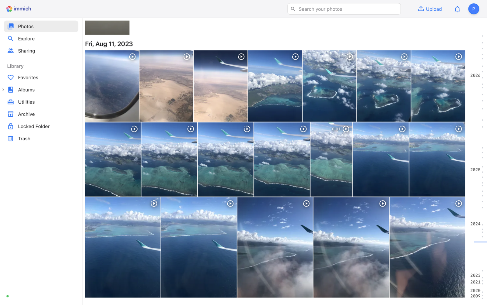
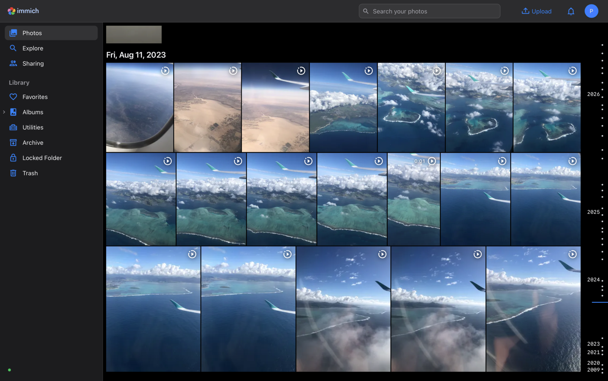

# Immich Apple Photos Inspired Theme

A custom CSS theme for [Immich](https://immich.app) inspired by Apple Photos / iCloud Photos.

| Light | Dark |
| --- | --- |
|  |  |

## Install

1. Open Immich as an admin.
2. Go to **Administration > Settings > Theme Settings > Custom CSS**.
3. Paste the contents of [`immich-apple-photos.css`](immich-apple-photos.css) and save.
4. Reload the page.

## What it changes

- **Colors and type:** Apple system blue accent, system font (SF Pro on macOS/iOS), light and dark variants.
- **Header:** flat light-gray bar, blue icons, compact search field on the right, smaller avatar.
- **Sidebar:** source-list style rows with blue icons, gray selection highlight, gray section titles. Storage card hidden, server status reduced to a dot.
- **Photo grid:** square thumbnails, no hover gradient, selection without shrinking (blue frame, checkmark bottom-right), larger date headers.
- **Albums:** flat cards, smaller rounded covers.
- **Photo viewer:** light background in light mode, solid toolbar with blue icons, photo placed below the toolbar.

## Limitations

- The grid layout (thumbnail positions and gaps) is computed in JavaScript, so it cannot be changed to the Apple "fit in square cells" layout with CSS alone.
- Immich uses generated Tailwind classes. Some selectors may break after an Immich update; issues and PRs are welcome.

Selectors checked against Immich `main` (October 2026).

## License

[MIT](LICENSE). Not affiliated with or endorsed by Apple Inc. or Immich.
